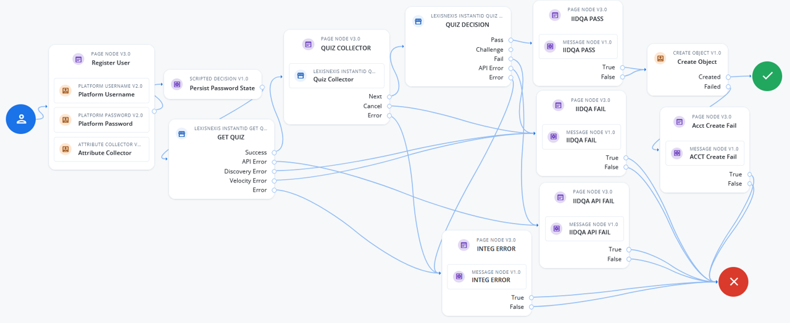

# LexisNexis Identity Proofing InstantID Question and Answer (IIDQA) Nodes
---
LexisNexis InstantID® Question and Answer (IIDQA) helps support speedy consumer onboarding, prevent and detect identity theft, and fortify compliance via question-based authentication tools, effectively helping organizations protect their business.  LexisNExis IIDQA nodes provide the capability for administrators to integrate Knowledge Based Authentication (KBA) into both PingOne Advanced Identity Cloud (PingOne AIC), formerly ForgeRock Identity Cloud, and Ping Access Management (PingAM), formerly ForgeRock Access Management.

LexisNexis IIDQA is primarily integrated into the following orchestration journeys:
- Login Multi-Factor Authentication (MFA) for medium to high risk transactions
- New Account Origination to prevent synthetic accounts, as well as validating the account is linked to a physical person with high fidelity

## Installation
For the on-premise PingAM / ForgeRock, LexisNexis IIDQA Nodes are packaged as a jar file that is to be installed within the web server. To deploy the jar file, perform the following:
- Download the jar from the releases tab on github [here](https://github.com/ForgeRock/tntp-threatmetrix-IIDQA/releases/latest). 
- Stop the web container to deploy the jar file
- Copy the jar into the `../web-container/webapps/openam/WEB-INF/lib` directory where PingAM / ForgeRock is deployed
- Restart the web container to pick up the new nodes
- Once restart is complete, the nodes will then appear in the authentication trees components palette.

## Compatibility

<table>
  <colgroup>
    <col>
    <col>
  </colgroup>
  <thead>
  <tr>
    <th>Product</th>
    <th>Compatible?</th>
  </tr>
  </thead>
  <tbody>
  <tr>
    <td>
Ping Advanced Identity Cloud (PingAIC)
</td>
    <td>
Yes
</td>
  </tr>
  <tr>
    <td>
Ping Access Management (PingAM) (self-managed)
</td>
    <td>
Yes
</td>
  </tr>
  </tbody>
</table>

## Backwards Compatibility
LexisNexis IIDQA Nodes have been tested with PingAM / ForgeRock v8.0, with backwards compatibility to v7.3, v7.4 and v7.5. Due to changes in the PingAM / ForgeRock APIs, the LexisNexis DDP Nodes are not compatible with versions prior to v7.3.

## Quick Start Guide
In order to get started with the LexisNexis IIDQA Nodes, we have prepared a Quick Start Guides:
- Click [here](./docs/LNRS-IIDQA-Nodes-Getting-Started-Guide-PingAIC.pdf) to download a copy of the quick start guide for PingOne AIC / ForgeRock.
- Click [here](./docs/LNRS-IIDQA-Nodes-Getting-Started-Guide-PingAM.pdf) to download a copy of the quick start guide for PingAM / ForgeRock.

## Release Notes
To get the latest version of the LexisNexis IIDQA Nodes release notes, click [here](./docs/LNRS-IIDQA-Nodes-Release-Notes.pdf) 

# Node Overview
---
LexisNexis InstantID® Question and Answer (IIDQA) Nodes provide the following:
- LexisNexis InstantID Get Quiz
- LexisNexis InstantID Quiz Collector
- LexisNexis InstantID Quiz Decision

## LexisNexis InstantID Get Quiz
The LexisNexis IIDQA Get Quiz node calls the LexisNexis Dynamic Decision Platform (DDP) Authentication Hub to generate an IIDQA quiz based on the identity data provided to the node. There is no interface displayed to the user by this node. The LexisNexis IIDQA Get Quiz node is configured with an attribute mapping to gather parameters for the API Request to send to the DDP Authentication Hub for generating a knowledge based answer (KBA) quiz. The Attribute Source defines where the attribute mapping information will be fetched at runtime, mainly either User Directory or Shared State. When the user directory is configured as the source for attributes, the node will assume that the username is contained in shared state from a previous node in the authentication tree/journey and use that username to query the user directory for user parameters and fulfill the attribute mapping. When the shared state is configured as the source for attributes, the node will inspect shared state for the user parameters to fulfill the attribute mapping.

### Input
The LexisNexis IIDQA Get Quiz node retrieves the following from the journey shared state based upon the configuration of the `Attribute Source` parameter.
* **AM Username (`username`)** - Required in shared state, or `objectAttributes`, to resolve the desired AM identity when the `Attribute Source = User Directory`. 
  * When **Query Attributes** are defined and the **Add Attributes to API Request** is enabled, the node will fetch user attributes based on the attribute name configured from the AM Identity of the corresponding `username`.
* **`objectAttributes`** - Required when the `Attribute Source = Shared State`.
  * When **Query Attributes** are defined and the **Add Attributes to API Request** is enabled, the node will fetch user attributes from shared state.

### Configuration
The LexisNexis IIDQA Get Quiz node has the following configuration parameters:
* **Org ID** - Org ID is the unique id associated with DDP generated for your organization.
* **API Key** - This is the unique API key generated by DDP associated to the Org ID.
* **Base URL** - Defines the domain URL for the DDP region where IIDQA API Requests are to be sent. The default value is the global region.
* **Policy** - The DDP Portal policy to be used to integrate the DDP Authentication Hub with IIDQA
* **Attribute Source** - This determines where the LexisNexis IIDQA Get Quiz node will inspect and gather user parameters to be mapped into the attributes of the IIDQA API Request to get a quiz. This can be configured for User Directory or form Shared State. User Directory is typically configured in a orchestration where IIDQA is used for Multi-Factor Authentication (MFA) since the information for the user should be in the directory. The Shared State specification is typically configured in an orchestration where IIDQA is used for identity proofing for use cases such as new account origination since the user account does not exist.  When Shared State is used there should be an interface in the tree/journey to collect the information which stores the data in shared state.
* **Attribute List** - Defines a mapping of user parameters to IIDQA API attributes. The user parameters will be fetched based on the Attribute Source. The “Key” defines the IIDQA attribute and the “Value” defines the parameter to fetch.  For example, Attribute Source=Shared State, with attribute list key=account_first_name and value=givenName would signal the LexisNexis IIDQA Get Quiz node to fetch the user parameter givenName from shared state and then set the IIDQA attribute account_first_name for the API Request. The attributes to send to IIDQA should include account_first_name, account_last_name, account_address_street1, account_address_city, account_address_state and account_address_zip as this will have a good probably to match a record in the LexisNexis system resulting in a generated quiz.

### Outputs
The LexisNexis IIDQA Get Quiz node has the following outputs placed into shared state: 
* **IIDQA Quiz** - When the get quiz operation is successful, the quiz from the API response will be contained in the state variable `iidqa.quiz`. This JSONObject value is further processed by the LexisNexis IIDQA Quiz Collector node.
* **IIDQA Request ID** - The Request ID (e.g. attribute <code>request_id</code>) associated to the DDP Authentication Hub API Response for IIDQA will be placed into state variable `iidqa.request_id`. This String value is used by the LexisNexis IIDQA Decision node to invoke an API Request with quiz answers for validation.
* **Failure Reason** - If an error outcome is generated, the state variable `iidqa.failure_reason` will contain text associated with the error condition.

### Callbacks
The LexisNexis IIDQA Get Quiz node does not have any callbacks as there is no user interface displayed.

### Outcomes 
The LexisNexis IIDQA Get Quiz Node has the following outcomes:
* **Success** - This outcome is triggered when the API Request results in a physical match to a person based on the Attribute List and a quiz is generated. The quiz is placed into Shared State for the IIDQA Quiz Collector Node, which will display the user interface for the quiz to collect the answers.
* **API Error** - This outcome is triggered when there is an issue with the API Request such as a network timeout or the service is unavailable.
* **Discovery Error** - This outcome is triggered when a physical match to a person cannot be made based on the attribute list provided in the IIDQA API Request. In this scenario, the journey/tree may display a secondary interface to collect additional user parameters such as DOB or SSN enabling a higher probability for an identity match.
* **Velocity Error** - This outcome is triggered based on the IIDQA policy configured within LexisNexis. Typically, we configure the system to only allow 3 quiz requests over a 30 minutes period to prevent guessing attacks.
* **Error** - This outcome is triggered when there is a fundamental integration error. First attempt to fix the integration error by looking at debug log files for the node to determine if the integration error is due to configuration. If the configuration looks accurate, then open a support case with LexisNexis Risk Solutions.

## LexisNexis InstantID Quiz Collector
This node displays the user interface for a quiz generated by the LexisNexis IIDQA Get Quiz Node. The quiz questions are passed through shared state from the get quiz node to the quiz collector node. Once received, the interface will be displayed to the user for knowledge-based questions to be answered.  Once submitted, the answers are placed into shared memory for the LexisNexis IIDQA Decision Node.

### Input
The LexisNexis IIDQA Quiz Collector node retrieves the following from the journey shared state:
* **IIDQA Quiz** - Required in shared state that is rendered by the LexisNexis IIDQA Quiz Collector node to generate the user interface. The quiz is contained in the state variable named `iidqa.quiz`.

### Configuration
The LexisNexis IIDQA Quiz Collector Node has the following configuration parameters:
* **N/A** - There are no configuration parameters for this node.

### Outputs
The LexisNexis IIDQA Quiz Collector node has the following outputs placed into shared state: 
* **IIDQA Quiz Answers** - When the user completes the quiz, the associated answer JSONObject is placed into state variable `iidqa.quiz_answers`. This value is further processed by the LexisNexis IIDQA Decision node.
* **Failure Reason** - If an error outcome is generated, the state variable `iidqa.failure_reason` will contain text associated with the error condition.

### Callbacks
he LexisNexis IIDQA Quiz Collector node has the following callbacks:
* When a valid IIDQA Quiz is contained in the state variable `iidqa.quiz`, the following callbacks for the user interface are returned:
  * `TextOutputCallback` - When an error occurs and needs to be displayed to the user, the first `TextOutputCallback` container will contain the error message to display to the user. The container will be marked as `TextOutputCallback.ERROR`.
  * For each Quiz Question contained in the **IIDQA Quiz** state variable named `iidqa.quiz`, the following callback structures will be created:
    * `TextOutputCallback` - Contains the Question that the user must respond with a selection.
    * `TextOutputCallback` - Contains help text with respect to the question to help the user make a selection.
    * `ChoiceCallback` - Contains an array of choices that are displayed to the user to select a specific answer.
  * `ConfirmationCallback` - Contains buttons for the user interface, mainly Submit and Cancel buttons.
  * `HiddenValueCallback` - Container that persists the quiz between callbacks. This information is used to build up the quiz answers.

### Outcomes 
The LexisNexis IIDQA Quiz Collector Node has the following outcomes:
* **Next** - This outcome triggers when quiz answers are complete and the submit button is selected by the user.
* **Cancel** - This outcome is triggered when the user selects the cancel button to abort the quiz.
* **Error** - This outcome is triggered when there is a fundamental integration error. First attempt to fix the integration error by looking at debug log files for the node to determine if the integration error is due to configuration. If the configuration looks accurate, then open a support case with LexisNexis Risk Solutions.

## LexisNexis InstantID Quiz Decision
This node calls the LexisNexis Dynamic Decision Platform (DDP) Authentication Hub for InstantID Question and Answer (IIDQA). The main purpose of this node is to call the DDP Authentication Hub to validate answers for a quiz. There is no interface displayed to the user by this node. The quiz answers are passed through shared state from the quiz collector node to the quiz decision node. Once received, the DDP Authentication Hub IIDQA API Request is generated and API Response inspected for success or failure.

### Input
The LexisNexis IIDQA Quiz Decision node retrieves the following from the journey shared state:
* **IIDQA Quiz Answers** - Required in shared state. The quiz answers from the LexisNexis IIDQA Quiz Collector node is fetched from the state variable named `iidqa.quiz_answers`. This JSONObject is used by the LexisNexis IIDQA Decision node to invoke an API Request with quiz answers for validation. 
* **IIDQA Request ID** - Required in shared state. The Request ID (e.g. attribute <code>request_id</code>) associated to the DDP Authentication Hub API Response from the IIDQA Get Quiz node is fetched from the state variable `iidqa.request_id`. This String value is used by the LexisNexis IIDQA Decision node to invoke an API Request with quiz answers for validation.

### Configuration
The LexisNexis IIDQA Quiz Decision node has the following configuration parameters:
* **Org ID** - Org ID is the unique id associated with DDP generated for your organization.
* **API Key** - This is the unique API key generated by DDP associated to the Org ID.
* **Base URL** - Defines the domain URL for the DDP region where API Requests are to be sent.  The default value is the global region.
* **Policy** - The DDP Portal policy to be used to integrate the DDP Authentication Hub with IIDQA. This policy configuration should be the same as the LexisNexis InstantID Get Quiz node configuration.
* **Store IIDQA API Response** - If enabled, the API Response from the IIDQA decision will be in the state variable named `iidqa.api_response`.

### Outputs
The LexisNexis IIDQA Quiz Decision node has the following outputs placed into shared state: 
* **IIDQA API Response** - When enabled, the API Response from the IIDQA decision will be in the state variable named `iidqa.api_response`.
* **Failure Reason** - If an error outcome is generated, the state variable `iidqa.failure_reason` will contain text associated with the error condition.

The LexisNexis IIDQA Quiz Decision node will keep the following information within shared state: 
* **IIDQA Request ID** - The Request ID associated to the DDP Authentication Hub API Response from the IIDQA Get Quiz node contained state variable `iidqa.request_id`.

The LexisNexis IIDQA Quiz Decision node cleans up and removes IIDQA data from shared state: 
* **IIDQA Quiz** - Removes tate variable `iidqa.quiz`.
* **IIDQA Quiz Answers** - Removes tate variable `iidqa.quiz_answers`.

### Callbacks
The LexisNexis IIDQA Quiz Decision node does not have any callbacks as there is no user interface displayed.

### Outcomes 
The LexisNexis IIDQA Quiz Decision Node has the following outcomes:
* **Pass** - This outcome is triggered when answers to a quiz are all passing according the DDP IIDQA policy
* **Fail** - This outcome is triggered when answers to a quiz are not passing according the DDP IIDQA policy
* **API Error** - This outcome is triggered when there is an issue with the API Request such as a network timeout or the service is unavailable.
* **Error** - This outcome is triggered when there is a fundamental integration error. First attempt to fix the integration error by looking at debug log files for the node to determine if the integration error is due to configuration. If the configuration looks accurate, then open a support case with LexisNexis Risk Solutions.

# Configuring LexisNexis InstantID Question and Answer (IIDQA) Nodes
---
## Example Journey/Tree - Registration IIDQA
The example depicts the general flow of IIDQA nodes. The workflow starts with gathering infomration from the user to create an account, where infomration is gathers via the attribute collector node and placed into shared memory. The LexisNexis InstantID Get Quiz node is invoked next. The LexisNexis IIDQA Get Quiz has been designed to either gather information from a user credential store to support MFA workflows, or from a user interface and shared state to support new account origination workflows. This jounrey/tree has been designed to gather from shared state as part of the registration workflow. Granted the information results in a physical identity match, a quiz will be generated by the LexisNexis IIDQA Get Quiz node. Processing continue to display the quiz and collect answers, finally ending in a quiz decision.

The flow is as follows:
•	Page Node. Gathers information from the user for the purposes of showing how registration identity proofing will operate with LexisNexis InstantID Question and Answer. Note that his flow is a happy path data flow to get starting using the nodes.  More complex use cases involve data mapping and data flow mapping along with IIDQA policy configuration.
•	LexisNexis IIDQA Get Quiz node. The configuration determines whether to pull user parameters from: (i) a user credential store, or (ii) from shared state in the journey/tree. The node then uses the information to generate an API Request. If insufficient information is available, LexisNexis risk Solutions physical identity matching will fail and a discovery error will be thrown by the node.
•	LexisNexis IIDQA Quiz Collector node. This node will display the quiz generated via the LexisNexis IIDQA Get Quiz Node. The user is expected to select the correct answers and click the submit button.
•	LexisNexis IIDQA Quiz Decision node to determine if the quiz answers collected from the user are valid and pass the test.
•	Page Nodes with messages and a single OK button that will display the results and/or error conditions.

